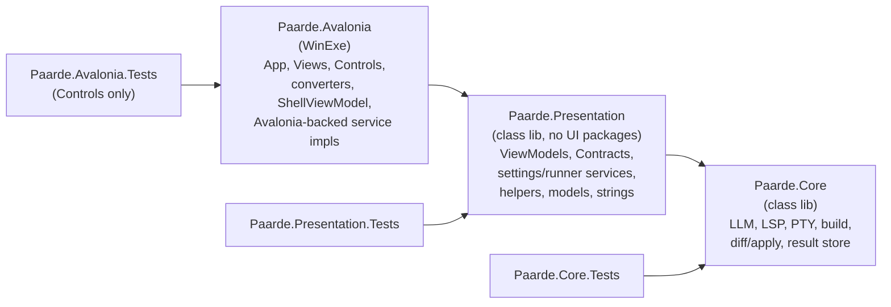

# Design — Presentation extraction (`Paarde.Presentation`)

See `requirements.md` for the inventory of what is Avalonia-bound today and why.

## Target layering



`Paarde.Presentation.csproj` packages: `CommunityToolkit.Mvvm`,
`Microsoft.Extensions.Logging.Abstractions`, `Microsoft.Extensions.DependencyInjection.Abstractions`
(only if `AddPaardePresentation()` is added), `System.Security.Cryptography.ProtectedData`
(follows `SecureStorageService`). `InternalsVisibleTo Paarde.Presentation.Tests`.

## New abstractions (all in `Paarde.Presentation`)

### `NotificationSeverity` (`Models/`)

```csharp
public enum NotificationSeverity { Informational, Success, Warning, Error }
```

Same member names and order as `InfoBarSeverity`, so the Avalonia-side
`NotificationSeverityToInfoBarSeverityConverter` (`Paarde.Avalonia/Helpers/`) is a plain cast,
and each of the 8 `Severity="{Binding …}"` bindings just gains `Converter=`. A unit test asserts
the two enums stay aligned by name and value so a FluentAvalonia upgrade can't silently drift.

### `IUiDispatcher` (`Contracts/Services/`)

```csharp
public interface IUiDispatcher
{
    void Post(Action action);
    IUiTimer CreateTimer(TimeSpan interval, Action tick);
}

public interface IUiTimer : IDisposable
{
    void Start();
    void Stop();
}
```

- `AvaloniaUiDispatcher` (`Paarde.Avalonia/Services/`) → `Dispatcher.UIThread.Post` and
  `DispatcherTimer`. Registered singleton.
- `FakeUiDispatcher` (`Paarde.Presentation.Tests/Fakes/`) runs `Post` inline; its timer exposes
  `Tick()` so tests drive `PromptViewModel`'s elapsed-time ticker deterministically.
- Why not `SynchronizationContext`/`TimeProvider`: the view models are constructed off the UI
  thread in several DI paths, so capturing a context at construction isn't reliable, and
  `TimeProvider` timers fire on the thread pool, which would still need a marshal back to the UI
  thread. One small interface covers both needs.

### `AppTheme` (`Models/`)

`enum AppTheme { Default, Light, Dark }`. `IThemeSelectorService` changes to
`AppTheme Theme { get; }`, `SetThemeAsync(AppTheme)`. `ThemeSelectorService` maps to
`ThemeVariant` and keeps today's persisted string values ("Default"/"Light"/"Dark"), so there's no
settings migration. `SettingsViewModel.SwitchThemeCommand` becomes `RelayCommand<AppTheme>`;
`EnumToBooleanConverter`'s `ThemeVariant` special case is deleted (it already handles real enums
via `Enum.Parse`).

### `INavigationService` (moved to `Contracts/Services/`, reshaped)

```csharp
public interface INavigationService
{
    bool CanGoBack { get; }
    bool NavigateTo(string pageKey, object? parameter = null, bool clearNavigation = false);
    bool GoBack();
}
```

- As built: `Frame? Frame` **and** the `Navigated` event moved to an Avalonia-only
  `IFrameNavigationService : INavigationService` (`Paarde.Avalonia/Contracts/Services/`). The
  only subscribers of either were `ShellView.axaml.cs`/`ShellViewModel`, which stay in Avalonia,
  so no framework-neutral event was needed. DI registers `NavigationService` once and maps both
  interfaces to that instance.
- `INavigationAware` / `IConfirmNavigationAway` move unchanged.

### `IWindowAppearanceService` (`Contracts/Services/`)

`void ApplyTransparency(bool enabled);` — Avalonia impl does today's
`(App.MainWindow as MainWindow)?.ApplyTransparency(enabled)`.

## Move map

| From `Paarde.Avalonia/…` | To `Paarde.Presentation/…` | Notes |
| --- | --- | --- |
| `Models/*` (`InterfaceMode`, `LocalSettingsOptions`, `PromptLaunchRequest`) | `Models/` | |
| `Services/*SettingsKeys.cs` (12 files) | `Services/` | constants only |
| `Strings/Resources.cs` | `Strings/` | plain C# class; check for `.resx` dependencies at move time |
| `Contracts/ViewModels/*` | `Contracts/ViewModels/` | |
| `Contracts/Services/*` except `INavigationViewService`, `IPageService` | `Contracts/Services/` | after R2 reshaping |
| `Services/` `ActiveEditorContext`, `AnthropicApiOptionsProvider`, `ClaudeCliOptionsProvider`, `HeadroomCoordinator`, `HeadroomPromptSnoozeStore`, `HeadroomStatusStore`, `LanguageServerOptionsProvider`, `LlmRunnerSelector`, `LocalSettingsService`, `RunConfigurationsProvider`, `SecureStorageService`, `WorkingDirectoryContext` | `Services/` | |
| `Helpers/` `BreadcrumbPathBuilder`, `DiffLineRenderer`, `GhostTextDebouncer`, `GhostTextSuggestionState`, `SyntaxToken` | `Helpers/` | `SyntaxToken` only if `SyntaxTokenizer` (stays) can still see it — it can, via the project reference |
| `ViewModels/*` except `ShellViewModel` | `ViewModels/` | 23 files |

Stays: see requirements R4.

## Namespace and XAML updates

- `namespace Paarde.Avalonia.X` → `namespace Paarde.Presentation.X` in moved files.
- `.axaml`: `xmlns:vm="using:Paarde.Avalonia.ViewModels"` → `using:Paarde.Presentation.ViewModels`
  (13 occurrences), plus any `x:DataType` that uses a fully-qualified name. Compiled bindings
  (`AvaloniaUseCompiledBindingsByDefault`) make any miss a build error, not a runtime one.
- Code-behind and tests: update `using` directives; `ImplicitUsings` does not cover project
  namespaces.
- `PageService` keys stay `typeof(VM).FullName` — values change, but nothing persists them (T0.3
  verifies).

## Sequencing (keep the build green at every step)

1. **Fix leaks in place first**, still inside `Paarde.Avalonia` (abstractions live in
   `Paarde.Avalonia` temporarily). Each leak is one small, test-backed commit.
2. **Then move** files in dependency order: models/keys → contracts → services/helpers → view
   models. Pure `git mv` + namespace edits, so reviews are mechanical.
3. **Then move tests** and add the guard test.

Fixing in place first means the risky edits (dispatcher, navigation event) are reviewed with
unchanged file paths, and the moves are pure renames that are easy to review.

## Testing

- Baseline: record `dotnet build` warnings/errors and pass counts per test project before T1.
- Guard test (R6.2): `typeof(SomePresentationType).Assembly.GetReferencedAssemblies()` — no name
  starting with `Avalonia`, `FluentAvalonia`, `AvaloniaEdit`, `TextMateSharp`.
- Enum alignment test: `NotificationSeverity` ↔ `InfoBarSeverity` (lives in
  `Paarde.Avalonia.Tests`, the only place that can see both).
- New dispatcher-path tests per R6.4 using `FakeUiDispatcher`.
- Manual smoke (no headless host): launch app; switch theme; toggle transparency; navigate every
  page incl. back; run a prompt (elapsed ticker, streaming text); run a build in the Run panel;
  open the terminal; trigger an InfoBar of each severity.

## Risks

- **Missed `x:DataType` namespace** → compile error (good: caught at build).
- **DI lifetime drift** while introducing `AddPaardePresentation()` → keep it optional and
  diff the registration list before and after.
- **`InternalsVisibleTo`**: internal members in moved types that `Paarde.Avalonia` views use would
  stop compiling; resolve by making them public or adding `InternalsVisibleTo Paarde.Avalonia`
  (prefer public; record which).
