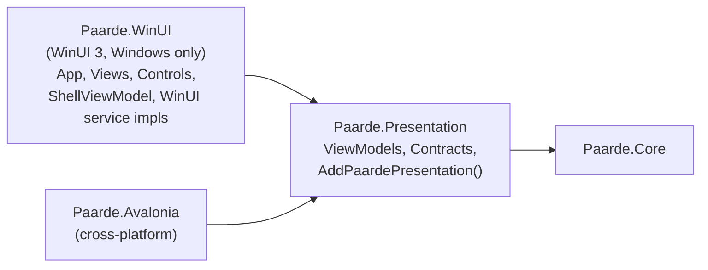
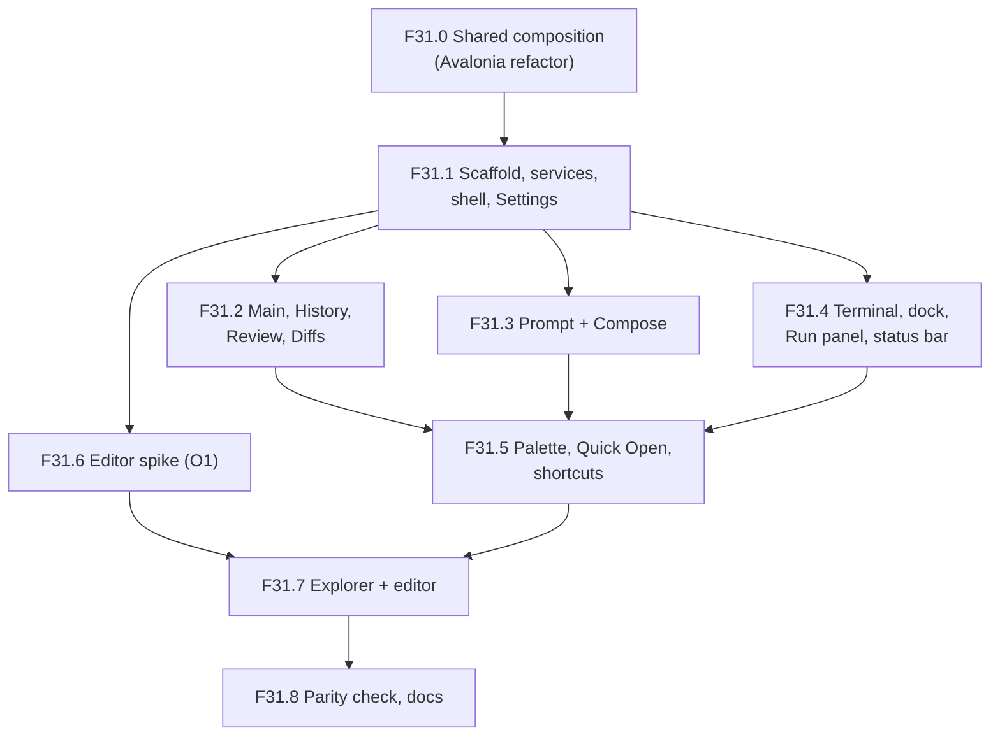

# Design — WinUI 3 front end (`Paarde.WinUI`)

See `requirements.md` for the inventory and requirements.

## Target layering



Solutions:

| File | Contains | Builds on |
| --- | --- | --- |
| `Paarde.slnx` (unchanged) | Core, Presentation, Avalonia + their tests | Windows, Linux, macOS |
| `Paarde.Windows.slnx` (new) | everything in `Paarde.slnx` + `Paarde.WinUI` | Windows only |

## Shared composition (R1)

```csharp
// Paarde.Presentation/ServiceCollectionExtensions.cs
public static IServiceCollection AddPaardePresentation(this IServiceCollection services);
```

- Moves from `App.axaml.cs`: every Core service, every Presentation service/options provider, the
  `LlmRunnerSelector`/`LanguageServerSessionManager`/`IRunSessionStore` factories, the keyed
  `IPtyProcessManager`, and all Presentation view models — same lifetimes.
- Stays in each host: `IUiDispatcher`, `INavigationService` (+ `IFrameNavigationService` in
  Avalonia), `IThemeSelectorService`, `IWindowAppearanceService`, `IDialogService`, the three
  pickers, `IPageService`, `INavigationViewService`, `ShellViewModel`, views, Serilog, and
  `services.Configure<LocalSettingsOptions>(configuration.GetSection(...))` (needs
  `Microsoft.Extensions.Options.ConfigurationExtensions`; keeping it in the host avoids adding that
  package to Presentation).
- `ResolveApplicationDataFolder(IConfiguration)` moves next to `LocalSettingsOptions` as a static
  helper (`ApplicationDataPaths.Resolve(string? configuredFolder)`), taking the configured string
  rather than `IConfiguration` so Presentation needs no configuration package.
- Verification: diff the registration list before/after (service type, implementation, lifetime,
  key) with a throwaway script; build, tests, launch.

## Project setup (R2)

- `Paarde.WinUI.csproj`: `OutputType=WinExe`, `UseWinUI=true`,
  `TargetFramework=net10.0-windows10.0.22621.0`, `TargetPlatformMinVersion=10.0.19041.0`,
  `Platforms=x64;ARM64`, `WindowsPackageType=None`, `WindowsAppSDKSelfContained=true` (no separate
  runtime install for an unpackaged app). Package versions pinned to the latest stable at T2 time.
- Host: `App` constructor builds the same Generic Host as Avalonia (`UseSerilog` →
  `ConfigureServices` → `AddPaardePresentation()` + WinUI registrations). `OnLaunched` creates
  `MainWindow`, resolves `ShellView`, applies saved theme and transparency, then activates.
- Logs: same `<ApplicationDataFolder>/Logs` folder, file prefix `winui-log-.txt` so both apps can
  run at once without contending for one rolling file.
- Bindings: `x:Bind` with a typed `ViewModel` property on each page (compile-checked, like
  Avalonia's compiled bindings, and no `[Bindable]`/reflection needed). `{Binding}` only where a
  template can't use `x:DataType`.

### Packages

| Package | Why | License |
| --- | --- | --- |
| `Microsoft.WindowsAppSDK` | WinUI 3 | MIT |
| `Microsoft.Windows.SDK.BuildTools` | required by WinAppSDK | MIT |
| `Microsoft.Graphics.Win2D` | `TerminalControl` drawing | MIT |
| `CommunityToolkit.WinUI.Controls.Sizers` | `GridSplitter` (replaces `ResizablePaneHelper`'s splitter) | MIT |
| `Microsoft.Extensions.Hosting`, `Serilog.*` | same as Avalonia | MIT / Apache-2.0 |
| editor (O1) | see below | must be permissive |

Licenses re-checked at T2 and recorded here.

## UI-specific services (R3)

| Contract | WinUI implementation | Notes |
| --- | --- | --- |
| `IUiDispatcher` | `WinUiDispatcher(DispatcherQueue)` → `TryEnqueue`; timer → `DispatcherQueue.CreateTimer()` | Constructed in `App`'s constructor (UI thread) with `DispatcherQueue.GetForCurrentThread()` and registered as an instance, because DI may first resolve it off the UI thread. |
| `INavigationService` | `NavigationService` over WinUI `Frame` | Port of the Avalonia one: `PageService.GetPageType(key)` → `Frame.Navigate(type, parameter)`; `INavigationAware.OnNavigatedFrom/To`, `IConfirmNavigationAway` before leaving, `clearNavigation` → `BackStack.Clear()`. Exposes `Frame` + `Navigated` only on a WinUI-side `IFrameNavigationService`, mirroring Avalonia. |
| `IThemeSelectorService` | `ElementTheme` on the window's root `FrameworkElement` | `AppTheme.Default/Light/Dark` ↔ `ElementTheme.Default/Light/Dark`; persists `theme.ToString()` under the existing key. Also updates title-bar button colors. |
| `IWindowAppearanceService` | `MainWindow.SystemBackdrop` = `MicaBackdrop` if `MicaController.IsSupported()`, else `DesktopAcrylicBackdrop`, else `null` | Same fallback order as Avalonia. |
| `IDialogService` | `ContentDialog` with `XamlRoot = MainWindow.Content.XamlRoot`, `DefaultButton = Close` for confirms | |
| Pickers | `FileOpenPicker` / `FileSavePicker` / `FolderPicker` + `InitializeWithWindow.Initialize(picker, hwnd)` | Required for unpackaged apps. |
| `IPageService` | same 7 `Configure<VM, View>()` registrations | |
| `INavigationViewService` + `ShellViewModel` | WinUI `NavigationView` / `NavigationViewItem` (`NavigationHelper.NavigateTo` attached property ported) | |

Converters needed (WinUI `IValueConverter` has a `string language` parameter, so Avalonia's can't
be shared): `NotificationSeverity` → `InfoBarSeverity` (int cast), `EnumToBoolean`,
`DiffLineKindToBackground`, bool → `Visibility` where `x:Bind` function binding doesn't cover it.

## Controls (R4)

### `TerminalControl`

Win2D `CanvasControl`; `Draw` walks `TerminalBuffer`'s cells exactly like the Avalonia
`Render(DrawingContext)` (fixed-cell grid measured from "M", Cascadia Mono → Consolas fallback).
Input: `CharacterReceived` + `KeyDown` translated to VT sequences → `InputReceived`; size changes →
`Resized(cols, rows)`. Port the Avalonia key-translation table rather than rewriting it.

### `MarkdownTextBlock`, `DiffWordSpanTextBlock`

Straight ports onto `RichTextBlock`/`TextBlock.Inlines` (`Run`, `Bold`, `Italic`, `Span`), keeping
the same dependency properties so view XAML ports 1:1.

### Code editor — open question O1

`CodeEditor` is confined to `ExplorerFileTabControl`, so the decision is deferred to a timeboxed
spike (T-F6) just before the Explorer port. Candidates, scored against R4.4's checklist (highlight,
two-way text, brackets, diagnostics, diff backgrounds, hunk gutter accept/reject, ghost text,
completion list, F12):

| Option | Fit | Cost / risk |
| --- | --- | --- |
| **Monaco in `WebView2`** (MIT) | Every R4.4 item is a documented Monaco API: markers, `deltaDecorations` (line + glyph-margin), inline-completions provider, completion provider, definition provider, bracket matching, TextMate-grade highlighting. | JS ↔ C# bridge for text sync and LSP callbacks; WebView2 memory per open tab (mitigate with one WebView2 + Monaco models per tab); offline bundling of Monaco assets. |
| **WinUIEdit** (Scintilla for WinUI; verify license) | Native; Scintilla indicators, markers, margins, autocomplete list cover most items. | Ghost text only as end-of-line annotations; syntax highlighting depends on which Lexilla lexers it exposes; smaller community. |
| Custom on Win2D | Full control | Re-implementing an editor; rejected. |

**Recommendation:** spike Monaco first (it's the only option that covers ghost text and
highlighting without compromise); fall back to WinUIEdit if WebView2 startup/memory is
unacceptable. The spike's output is a filled-in checklist + decision recorded here.

## Sequencing

Each feature leaves both apps building and the Avalonia app unchanged in behavior.



Settings first because it exercises every R3 service (theme, transparency, dialogs, pickers,
navigation) on the simplest page.

## Testing

- Build both solutions; run the three existing test projects (counts unchanged).
- F31.0: registration-list diff + Avalonia launch.
- Each feature: side-by-side manual check against the Avalonia app on the ported pages.
- No WinUI test project unless a feature produces non-XAML logic not already covered by
  `Paarde.Presentation.Tests` (WinUI unit tests need a packaged test app, which is heavy).

## Risks

- **Editor (O1)** is the largest unknown; isolated to one view and deferred until the rest works.
- **`IConfirmNavigationAway` timing**: WinUI `Frame` navigation is synchronous; the async confirm
  has to run *before* calling `Frame.Navigate` (as Avalonia's `NavigationService` already does),
  not in `OnNavigatingFrom`.
- **Keyboard shortcuts**: Avalonia `KeyBinding`s in `ShellView` become `KeyboardAccelerator`s;
  some (F12 in the editor, Ctrl+Tab) may be swallowed by focused controls and need
  `ProcessKeyboardAccelerators` handling.
- **Shared settings**: a WinUI-only setting added later must not break the Avalonia app — keep all
  keys in Presentation's `*SettingsKeys`, read with defaults.
- **Unpackaged APIs**: some Windows APIs (notifications, `ApplicationData`) need package identity;
  avoid them, keep using `%AppData%` paths.

## Open questions

- O1 — Code editor control (spike in F31.6).
- O2 — Should the settings folder eventually be renamed from `Paarde.Avalonia/ApplicationData` to
  something host-neutral? Not in this epic (would need a migration); sharing the current one is fine.
