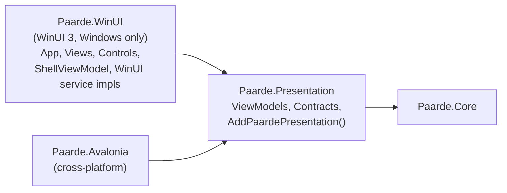
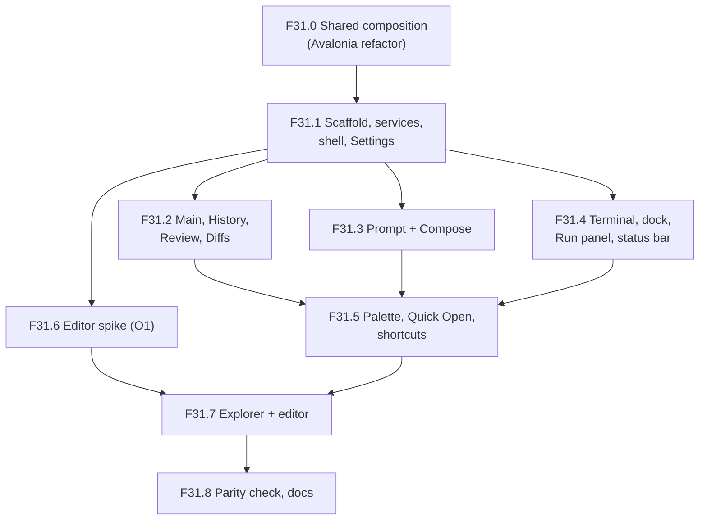

# Design — WinUI 3 front end (`Paarde.WinUI`)

See `requirements.md` for the inventory and requirements.

## Target layering



Solutions:

| File | Contains | Builds on |
| --- | --- | --- |
| `Paarde.slnx` (unchanged) | Core, Presentation, Avalonia + their tests | Windows, Linux, macOS |
| `Paarde.Windows.slnx` (new) | everything in `Paarde.slnx` + `Paarde.WinUI` | Windows only |

## Shared composition (R1)

```csharp
// Paarde.Presentation/ServiceCollectionExtensions.cs
public static IServiceCollection AddPaardePresentation(this IServiceCollection services);
```

- Moves from `App.axaml.cs`: every Core service, every Presentation service/options provider, the
  `LlmRunnerSelector`/`LanguageServerSessionManager`/`IRunSessionStore` factories, the keyed
  `IPtyProcessManager`, and all Presentation view models — same lifetimes.
- Stays in each host: `IUiDispatcher`, `INavigationService` (+ `IFrameNavigationService` in
  Avalonia), `IThemeSelectorService`, `IWindowAppearanceService`, `IDialogService`, the three
  pickers, `IPageService`, `INavigationViewService`, `ShellViewModel`, views, Serilog, and
  `services.Configure<LocalSettingsOptions>(configuration.GetSection(...))` (needs
  `Microsoft.Extensions.Options.ConfigurationExtensions`; keeping it in the host avoids adding that
  package to Presentation).
- `ResolveApplicationDataFolder(IConfiguration)` moves next to `LocalSettingsOptions` as a static
  helper (`ApplicationDataPaths.Resolve(string? configuredFolder)`), taking the configured string
  rather than `IConfiguration` so Presentation needs no configuration package.
- Verification: diff the registration list before/after (service type, implementation, lifetime,
  key) with a throwaway script; build, tests, launch.

## Project setup (R2)

- `Paarde.WinUI.csproj`: `OutputType=WinExe`, `UseWinUI=true`,
  `TargetFramework=net10.0-windows10.0.26100.0` (matches the current `dotnet new winui` template),
  `TargetPlatformMinVersion=10.0.19041.0`, `Platforms=x64;ARM64`, `RuntimeIdentifier` defaulting to
  the build machine's architecture (template pattern, so `dotnet build` of the solution works),
  `WindowsPackageType=None`, `WindowsAppSDKSelfContained=true` (no separate runtime install for an
  unpackaged app), `EnableMsixTooling=true` (still needed unpackaged: it generates `resources.pri`).
  Package versions pinned to the latest stable at T2 time.
- Pages navigated by `Frame` must be XAML pages: `Frame.Navigate` to a code-only `Page` subclass
  crashes natively (0xC0000005) because the XAML compiler emits no type metadata for it. Not-yet-
  ported pages are therefore one-line XAML placeholders, not C# stubs.
- Host: `App` constructor builds the same Generic Host as Avalonia (`UseSerilog` →
  `ConfigureServices` → `AddPaardePresentation()` + WinUI registrations). `OnLaunched` creates
  `MainWindow`, resolves `ShellView`, applies saved theme and transparency, then activates.
- Logs: same `<ApplicationDataFolder>/Logs` folder, file prefix `winui-log-.txt` so both apps can
  run at once without contending for one rolling file.
- Bindings: `x:Bind` with a typed `ViewModel` property on each page (compile-checked, like
  Avalonia's compiled bindings, and no `[Bindable]`/reflection needed). `{Binding}` only where a
  template can't use `x:DataType`.

### Packages

| Package | Version | Why | License |
| --- | --- | --- | --- |
| `Microsoft.WindowsAppSDK` | 2.6.5 | WinUI 3 | **Microsoft Software License Terms – Windows App SDK** (free, redistributable, "solely for use on Windows"; checked in the package's `license.txt` at T2). Not MIT: only the WinUI *source* repo is MIT. Accepted as the platform itself - see R2.4. |
| `Microsoft.Windows.SDK.BuildTools` | 10.0.28000.2957 | build tooling WinAppSDK needs | Microsoft license (build-time only, not redistributed) |
| `Microsoft.Extensions.Hosting`, `Serilog.*` | same as Avalonia | host + logging | MIT / Apache-2.0 |
| ~~`Microsoft.Graphics.Win2D`~~ | not used | was planned for `TerminalControl` drawing | Checked at F31.4: the NuGet package is under Microsoft's Win2D EULA, not MIT (only the source repo is MIT). Dropped: `TerminalControl` draws with plain XAML elements instead (below). |
| `CommunityToolkit.WinUI.Controls.Sizers` | 8.2.251219 (added F31.2) | `GridSplitter`; `ResizablePaneHelper.AttachSplitter` persists the width on `ManipulationCompleted` | MIT |
| `TextMateSharp.Grammars` (in `Paarde.Presentation`) | 2.0.5 (F31.2) | `SyntaxTokenizer`, moved out of Avalonia so both front ends share it | MIT |
| `monaco-editor` (npm, `min/vs` AMD build, not a NuGet package) | 0.57.0 (chosen F31.6) | the code editor, hosted in `WebView2` (below) | MIT (checked in the package's `LICENSE`) |
| `Microsoft.Web.WebView2` | 1.0.3719.77, transitive via Windows App SDK (no new reference) | the `WebView2` control's SDK | BSD-3-Clause (checked in the package's `LICENSE.txt`) |
| WebView2 Runtime (Evergreen) | system component (157.0 on the dev machine) | the browser engine `WebView2` runs on | Microsoft license; ships with Windows 11 and is installed on almost all Windows 10 machines. Not redistributed by Paarde. Accepted as a platform component, like Windows App SDK (R2.4). |

Licenses are checked against each package's own license file when it's added, not assumed from
the source repo.

## UI-specific services (R3)

| Contract | WinUI implementation | Notes |
| --- | --- | --- |
| `IUiDispatcher` | `WinUiDispatcher(DispatcherQueue)` → `TryEnqueue`; timer → `DispatcherQueue.CreateTimer()` | Constructed in `App`'s constructor (UI thread) with `DispatcherQueue.GetForCurrentThread()` and registered as an instance, because DI may first resolve it off the UI thread. |
| `INavigationService` | `NavigationService` over WinUI `Frame` | Port of the Avalonia one: `PageService.GetPageType(key)` → `Frame.Navigate(type, parameter)`; `INavigationAware.OnNavigatedFrom/To`, `IConfirmNavigationAway` before leaving, `clearNavigation` → `BackStack.Clear()`. Exposes `Frame` + `Navigated` only on a WinUI-side `IFrameNavigationService`, mirroring Avalonia. |
| `IThemeSelectorService` | `ElementTheme` on the window's root `FrameworkElement` | `AppTheme.Default/Light/Dark` ↔ `ElementTheme.Default/Light/Dark`; persists `theme.ToString()` under the existing key. Also updates title-bar button colors. |
| `IWindowAppearanceService` | `MainWindow.SystemBackdrop` = `MicaBackdrop` if `MicaController.IsSupported()`, else `DesktopAcrylicBackdrop`, else `null` | Same fallback order as Avalonia. |
| `IDialogService` | `ContentDialog` with `XamlRoot = MainWindow.Content.XamlRoot`, `DefaultButton = Close` for confirms | |
| Pickers | Windows App SDK's `Microsoft.Windows.Storage.Pickers` (`FileOpenPicker` / `FileSavePicker` / `FolderPicker`) constructed with `AppWindow.Id` | Not the UWP-era `Windows.Storage.Pickers`: no `InitializeWithWindow` interop, plain paths back, and they work elevated. No settable title, so `IFileSavePickerService`'s `title` is unused. |
| `IPageService` | same 7 `Configure<VM, View>()` registrations | |
| `INavigationViewService` + `ShellViewModel` | WinUI `NavigationView` / `NavigationViewItem` (`NavigationHelper.NavigateTo` attached property ported) | |

Converters: replaced by `x:Bind` function bindings in `Helpers/BindingFunctions.cs`
(`ToInfoBarSeverity`, `IsEnumValue`, `IsNotEmpty`, `VisibleIf`/`CollapsedIf`/`VisibleIfNotNull`) -
compile-checked and no resources to declare. Enum radio groups bind `IsChecked` one-way and set
the view model from `Checked` handlers (Tag = member name), because `x:Bind`'s generated two-way
code casts whatever `ConvertBack` returns and so can't ignore an unchecked button.
F31.2 added `DiffLineBackground`/`DiffCellBackground` for diff row tints.

Diff and step lists (F31.2) are `ListView`s with `SelectionMode="None"` (virtualized, and
`ScrollIntoView` for change/step navigation). The diff lists sit in a horizontal-only outer
`ScrollViewer` so long lines scroll instead of clipping. `DataTemplate`s can't reach the parent's
DataContext, so rows are wrapped in records that carry the file path (`DiffRowItem`,
`SideBySideRowItem`).

Other WinUI-specific notes from F31.1: `x:Bind` defaults to `OneTime`, so every live binding
states `Mode=OneWay`/`TwoWay` (text boxes add `UpdateSourceTrigger=PropertyChanged` to match
Avalonia's commit-per-keystroke); `[ObservableProperty]` in `Paarde.WinUI` uses partial properties
(MVVMTK0045), while Presentation's field-based ones are left alone; the theme setting key moved to
`AppearanceSettingsKeys.RequestedTheme` so both `ThemeSelectorService`s share it.

## Controls (R4)

### `TerminalControl`

Plain XAML on a `Canvas`, not Win2D (see Packages). Per row: one `Rectangle` per run of the same
background colour, and one `TextBlock` per run of same-style text, placed at its exact column, so
a monospace font can't drift out of the grid by more than one run. Wide characters always get a
run of their own. Rows whose cells are unchanged since the last refresh are left alone, and
`TerminalBuffer.Changed` (raised on the PTY thread) is coalesced to one refresh per UI-thread turn.
The cell is measured from a run of "M"s in `MonospaceFontFamily`, with row height snapped to whole
device pixels so row backgrounds don't anti-alias into seams.
Input: `PreviewKeyDown` (so Tab and the arrow keys reach the PTY rather than moving focus) uses
Avalonia's key-translation table, ported as-is, and `CharacterReceived` sends printable
characters, including surrogate pairs. AltGr (Ctrl+Alt) is left to `CharacterReceived` so it
still types characters. Size changes → `Resized(cols, rows)`.
The `Changed` subscription only lives while the control is loaded, because the buffers are
singletons that outlive the pages hosting them.

The workbench dock: WinUI has no `TabControl`, so a `SelectorBar` (Build/Run/Problems/Terminal,
`Tag` = `ActiveTabKey`) toggles which of four panes is visible inside the `Expander`.

### `MarkdownTextBlock`, `DiffWordSpanTextBlock`

Straight ports onto `RichTextBlock`/`TextBlock.Inlines` (`Run`, `Bold`, `Italic`, `Span`), keeping
the same dependency properties so view XAML ports 1:1.

### Code editor — O1, decided in F31.6: Monaco in `WebView2`

**Decision: Monaco 0.57.0 hosted in `WebView2`.** The spike (a throwaway WinUI app outside the
repo, same Windows App SDK setup as `Paarde.WinUI`) passed every R4.4 item, so WinUIEdit was not
evaluated. The spike drove Monaco from C# through a small message bridge, with fake C# responders
standing in for the LSP and ghost-text services, and was checked with real keystrokes, mouse clicks
and screenshots.

| R4.4 item | Result | How |
| --- | --- | --- |
| Syntax highlighting | ✅ | Monaco's built-in C# grammar (and ~80 others). It's Monarch, not TextMate, so colours differ slightly from Avalonia's Dark+ TextMate theme. |
| Two-way text | ✅ | Host → editor: `setText`, suppressing the echo. Editor → host: `textChanged` on every edit. Caret → host for the status bar. |
| Bracket highlighting | ✅ | `matchBrackets: 'always'`, plus bracket-pair colours by default. |
| Diagnostics squiggles | ✅ | `monaco.editor.setModelMarkers`. Error and warning squiggles show, and the markers follow edits. |
| Diff line backgrounds | ✅ | A whole-line decoration collection with the same red/green tints as `BindingFunctions.DiffLineBackground`. |
| Hunk gutter accept/reject | ✅ | Two glyph-margin lanes (✓ left, ✗ right) on the hunk's first line. Clicks report the hunk index and action. The lane is read from the clicked glyph's CSS class: Monaco's `detail.glyphMarginLane` reported "accept" for both lanes. |
| Ghost text | ✅ | `registerInlineCompletionsProvider` asks C# and awaits the reply. Shown inline and accepted with Tab, as in VS Code. |
| LSP completion list | ✅ | `registerCompletionItemProvider` asks C# and awaits the items. Monaco filters and inserts them. |
| Go to definition (F12) | ✅ | `addCommand(F12)` reports the position, and C# reveals the target. Paarde resolves cross-file jumps itself, so no definition provider is registered. |
| Also checked | ✅ | Hover (Markdown, with a highlighted code block); live dark/light theme switch; Monaco's own Ctrl+F find. |

**Bridge:** `chrome.webview.postMessage` for JS → C#. C# → JS goes through `ExecuteScriptAsync`
calls on a small `window.paarde` API. Request/response features (completion, hover, ghost text)
carry an id that C# answers with `paarde.resolve(id, value)`. This matches the existing
`CompletionRequested`/`HoverRequested` events plus bound result properties on Avalonia's
`CodeEditor`, so `ExplorerFileTabControl`'s wiring ports unchanged.

**Measured (Debug, dev machine):**
- Cold start is 555–690 ms from creating the `WebView2` to a ready editor; a second instance is
  ready in 243 ms.
- Memory: the app process uses 95 MB private, and the six WebView2 processes for one editor
  200 MB. A second `WebView2` added one process and **+93 MB**.

**Findings that shape F31.7:**
- **One `WebView2` per Explorer page, not per tab.** Each open tab gets its own Monaco model, and
  `setModel` plus `saveViewState`/`restoreViewState` switch tabs. This avoids ~90 MB per open tab.
  Avalonia gives each `ExplorerFileTabControl` its own `CodeEditor`, so the WinUI editor will sit
  outside the `TabView` items and follow the selected tab. _(F31.7: one per tab group, so at most
  two. The split group's editor is created by `x:Load` when a tab is first split right and thrown
  away when its last tab closes.)_
- **Keyboard:** WebView2 has its own input queue, so WinUI `KeyboardAccelerator`s never see keys
  pressed inside the editor. The page forwards Ctrl+P, Ctrl+Shift+P and Ctrl+Shift+O to C#;
  forwarding was verified. `AreBrowserAcceleratorKeysEnabled = false` turns off browser keys such
  as Ctrl+P (print) and F5 (reload).
- **Focus:** once in seven window deactivate/reactivate cycles, keystrokes after reactivation went
  nowhere. Fix for F31.7: on `Window.Activated`, if the editor had focus, call
  `WebView2.Focus` and the editor's `focus()`.
- **Offline assets:** `SetVirtualHostNameToFolderMapping("paarde.editor", …)` serves `min/vs` from
  the output folder, with no network access and no file:// URLs.
- **Monaco's file names:** copy `min/vs` as `None` items, not `Content`. The resource indexer reads
  hashed names like `monaco.contribution-BuX2NvO2.js` as resource qualifiers and raises a warning
  per file (14 in the spike), which would break the 0-warning rule.
- **AMD build:** Monaco marks its AMD build (`loader.js`) deprecated in favour of ESM, which needs a
  bundler. AMD is still in 0.57.0, needs no JavaScript build step, and is pinned. Moving to ESM is
  only needed if a future upgrade drops AMD.
- **Text sync:** the spike sends the full text on every edit. _(F31.7 kept this rather than
  debouncing: a debounce would let Save write text that's a few keystrokes stale, and the full
  text of a source file is cheap to post.)_
- **Getting `min/vs` into the build (O3, decided in F31.7): downloaded at build time.** The
  `DownloadMonaco` target in `Paarde.WinUI.csproj` fetches the pinned npm tarball
  (`MonacoVersion`), fails the build unless its SHA-512 matches `MonacoSha512`, and extracts
  `package/min/vs` and `LICENSE` with Windows' built-in `tar` into `obj/monaco/<version>/`. Node
  isn't needed, and later builds reuse the extracted copy. `IncludeMonaco` then adds the files as
  `None` items linked under `Editor\vs\`. Upgrading means changing the version and the hash
  together.

Original candidate list, kept for reference:

| Option | Fit | Cost / risk |
| --- | --- | --- |
| **Monaco in `WebView2`** (MIT) | Every R4.4 item is a documented Monaco API: markers, `deltaDecorations` (line + glyph-margin), inline-completions provider, completion provider, definition provider, bracket matching, TextMate-grade highlighting. | JS ↔ C# bridge for text sync and LSP callbacks; WebView2 memory per open tab (mitigate with one WebView2 + Monaco models per tab); offline bundling of Monaco assets. |
| **WinUIEdit** (Scintilla for WinUI; verify license) | Native; Scintilla indicators, markers, margins, autocomplete list cover most items. | Ghost text only as end-of-line annotations; syntax highlighting depends on which Lexilla lexers it exposes; smaller community. |
| Custom on Win2D | Full control | Re-implementing an editor; rejected. |

The plan was to spike Monaco first and fall back to WinUIEdit if WebView2's startup or memory was
unacceptable. Neither was, so the fallback wasn't needed.

## Sequencing

Each feature leaves both apps building and the Avalonia app unchanged in behavior.



Settings first because it exercises every R3 service (theme, transparency, dialogs, pickers,
navigation) on the simplest page.

## Testing

- Build both solutions; run the three existing test projects (counts unchanged).
- F31.0: registration-list diff + Avalonia launch.
- Each feature: side-by-side manual check against the Avalonia app on the ported pages.
- No WinUI test project unless a feature produces non-XAML logic not already covered by
  `Paarde.Presentation.Tests` (WinUI unit tests need a packaged test app, which is heavy).

## Risks

- **Editor (O1)** is the largest unknown; isolated to one view and deferred until the rest works.
- **`IConfirmNavigationAway` timing**: WinUI `Frame` navigation is synchronous; the async confirm
  has to run *before* calling `Frame.Navigate` (as Avalonia's `NavigationService` already does),
  not in `OnNavigatingFrom`.
- **Keyboard shortcuts**: Avalonia `KeyBinding`s in `ShellView` become `KeyboardAccelerator`s;
  some (F12 in the editor, Ctrl+Tab) may be swallowed by focused controls and need
  `ProcessKeyboardAccelerators` handling. _(F31.5: the shell's three accelerators work from
  every page and from inside the popups. `TerminalControl` handles keys in `PreviewKeyDown`, so a
  focused terminal keeps Ctrl+P, as in Avalonia. F31.7: F12/Shift+F12 are Monaco actions posted to
  C#; Ctrl+Tab, Ctrl+K Z and the three shell shortcuts are forwarded from the editor page, and
  `ExplorerView` handles Ctrl+Tab in `PreviewKeyDown` because `TabView` would otherwise take it.)_
- **Shared settings**: a WinUI-only setting added later must not break the Avalonia app — keep all
  keys in Presentation's `*SettingsKeys`, read with defaults.
- **Unpackaged APIs**: some Windows APIs (notifications, `ApplicationData`) need package identity;
  avoid them, keep using `%AppData%` paths.

## Open questions

- ~~O1 — Code editor control (spike in F31.6).~~ Decided: Monaco in `WebView2` (see "Code editor").
- ~~O3 — How `monaco-editor`'s `min/vs` gets into the build.~~ Decided in F31.7: downloaded at
  build time with a pinned SHA-512 (see "Code editor").
- O2 — Should the settings folder eventually be renamed from `Paarde.Avalonia/ApplicationData` to
  something host-neutral? Not in this epic (would need a migration); sharing the current one is fine.
